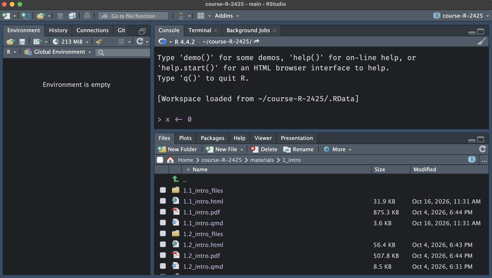
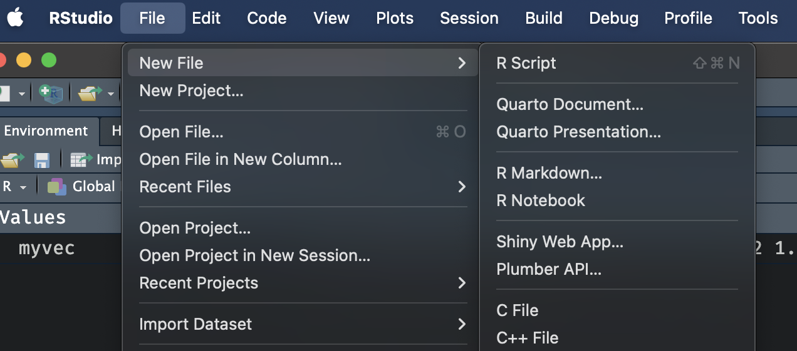
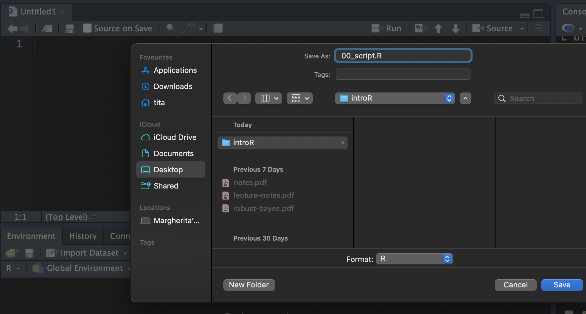
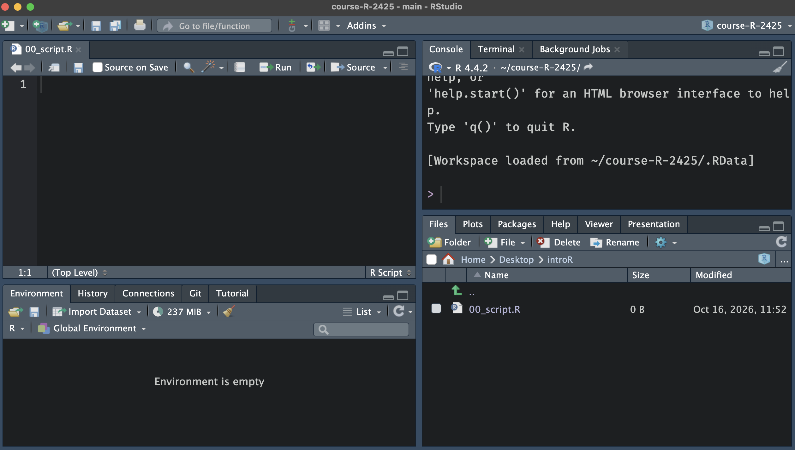

## RStudio

{fig-align="center" width="1000"}

## How to work in R

Let's create a **script**, a "text" file where you write and save your code.

<br/>

{fig-align="center" width="800"}

## How to work in R

Let's save it:

{fig-align="center"}

## Working Environment 

RStudio is divided into **4 main panes**:

{fig-align="center" width="2000"}

------------------------------------------------------------------------

RStudio is divided into **4 main panes**:

- **Script.** The text file where you write and save your code. You can run one line at a time (`Ctrl + Enter` / `Cmd + Enter`) or the whole script by clicking `Source`. Comments are added with `#`.


- **Console.** This is where R runs the code and shows the results. You can type commands directly in the console for quick tests, but they are not saved. 


- **Environment / Temporary desk.** Shows all the **objects** created during the current session.


- **Miscellaneous.** A multi-purpose pane with several tabs, including the file explorer.


## Working Directory

The location (folder) on your PC where R is working and where R expects to find your files, unless specified otherwise.

<br/>

```{r, echo = TRUE}
getwd()
```

## Absolute Path

PC

```         
|- Users
    |
    |- tita
        |
        |- course-R-2425
            |
            |- materials
                |
                |- 1_intro
```

<br/> I am working inside the 1_intro folder.

## Relative Path (to the working directory)

1.  Change the working directory with the `setwd` command:

```{r, echo=TRUE, eval=FALSE}
setwd('/Users/tita/Desktop/introR')
```

2.  Download the file [prova.csv](https://github.com/arca-dpss/course-R-2425/blob/main/materials/1_intro/prova.csv) and put it in the folder.

::: fragment
3.  Since we are working inside the folder, if we want to load a file located in this folder we can simply write the file name in quotes and use, for example, the `read.csv` function:

```{r, echo=TRUE, warning=FALSE}
data <- read.csv("prova.csv")
```
:::

## 

Now move the `prova.csv` outside the introR folder (e.g., in the desktop), and run the same command.. 

```{r, echo=TRUE, eval=FALSE}
data <- read.csv("prova.csv")
```

::: fragment
If we want to load a file located outside our `wd`, we need to refer to it through its absolute path:

```{r, echo=TRUE, warning=FALSE, eval=FALSE}
data <- read.csv("/Users/tita/Desktop/prova.csv")
```

:::

::: fragment
Or, first change the working directory with the `setwd` command and then load the file.

```{r, echo=TRUE, eval=FALSE}
setwd('/Users/tita/Desktop')
data <- read.csv("prova.csv")
```

:::

## The best solution?

Create an R project!

-   they set the working directory automatically
-   they let you use ***relative paths*** instead of ***absolute paths***
-   they give quick access to a given project

# Let's create one!
