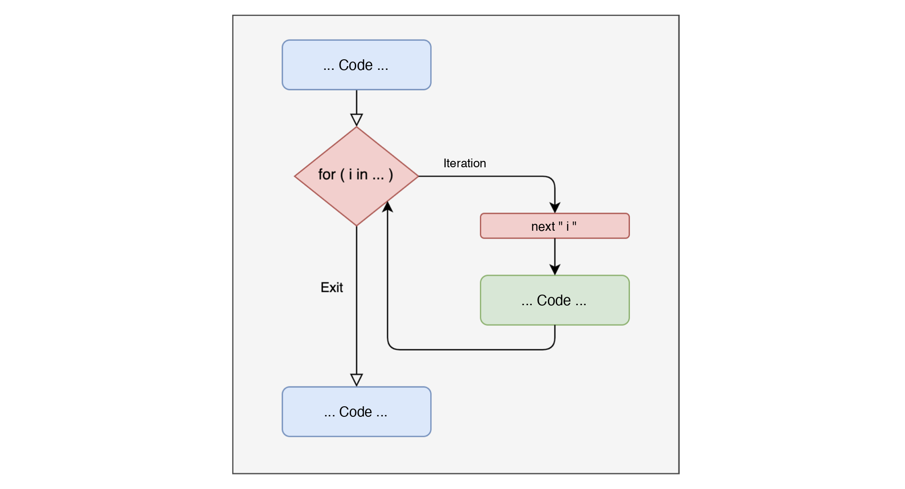
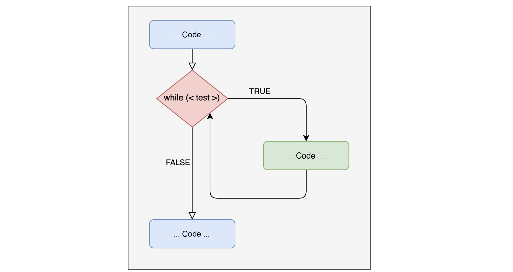

## Iterative programming


Example: if I ask you to use the **`print()`** function to write "hello world" in the console 5 times, how would you do it?

```{r, echo=TRUE}
msg <- "hello world"
print(msg)
print(msg)
print(msg)
print(msg)
print(msg)
```

------------------------------------------------------------------------

What we are missing is a way to repeat a given operation without actually repeating the code manually.

There are several constructs that let us repeat operations; the most used are:

-   The **`for`** loop

-   The **`while`** loop

-   The **`repeat`** loop

-   The **`*apply`** family

## The **`for`** loop

{fig-align="center"}

------------------------------------------------------------------------

The **`for`** loop is a structure that lets us repeat a portion of code a finite, pre-determined number of times.

A for loop is written as:

```{r, echo=TRUE, error}
n <- 10
for(i in 1:n){
# which operations
}
```

If I want to print something 5 times, I can simply use a for loop:

```{r, echo=TRUE}
for(i in 1:5){
print("hello world")
}
```

-----------------------------------------------------------------------


## Breaking down the **`for`** loop

-   **`for(){ }`**: this is the implementation in R (similar to the if statement)

-   **`i`**: this is called the iterator or index. It is a generic index that can take any value and name. By convention it is called i, j etc. It keeps track of the number of iterations our loop has to do

-   **`in <values>`**: this indicates the values the iterator will take inside the loop

-   **`{ # operations }`**: these are the operations the loop must perform


```{r, echo=TRUE}
for(i in 1:5){
print(paste("hello world", i, sep = " "))
}
```

------------------------------------------------------------------------

The power of the for loop lies in the fact that the **iterator** i takes the values of the vector specified after **`in`**, one at a time:

```{r, echo=TRUE}
for(i in 1:10){
  print(i)
}
```

------------------------------------------------------------------------

## **`For`** with an index vs without

::::: columns
::: {.column width="60%"}
**`i`** represents the index of the elements of the vector vec

```{r, echo=TRUE}
vec <- c(1,3,5,8)

for(i in 1:length(vec)){
  
  print(paste(i, vec[i], sep = " "))

  }
```
:::

::: {.column width="40%"}

::: fragment
**`i`** directly represents each element of the vector vec

```{r, echo=TRUE}
vec <- c(1,3,5,8)

for(i in vec){

  print(i)

}
```
:::
:::
:::::

## The **`while`** loop

The **`while`** loop uses a logical condition instead of an iterator and a range of values as in the for loop. The loop keeps going as long as the condition is **`TRUE`**:

{fig-align="center"}

------------------------------------------------------------------------

Try writing this **`while`** loop, see what happens and understand why

```{r, echo=TRUE, eval=FALSE}
x <- 10

while (x < 15) {

  print(x)

}
```

------------------------------------------------------------------------

The **`while`** loop is not pre-determined, so it always needs a way to be stopped, by making the condition false.

```{r, echo=TRUE}
x <- 5

while (x < 15) {
  print(x)
  x <- x + 1
}
```

## The **`repeat`** loop

The logic of the **`repeat`** loop is very similar to that of the **`while`** loop, but with 3 important differences:

1)  it always performs at least one iteration

2)  it emphasizes repetition until a condition is met

3)  it uses the **`break`** command to stop

## The **`repeat`** loop

Roll the die until a 6 comes up:

```{r, echo=TRUE}
repeat{
  die_roll <- sample(1:6, 1)
  print(die_roll)
  if(die_roll == 6) break
}
```

## **`repeat`** vs. **`while`**

**`repeat`** evaluates the condition at the **end** of the iteration, while **`while`** does it at the **beginning**. If the condition is not **`TRUE`** at the start, while does not run, whereas repeat does:

::::: columns
::: {.column width="50%"}
```{r, echo=TRUE}
i <- 1
repeat {
  print(i)
  i <- i+1
  if(i > 3)break
  }
```
:::

::: {.column width="50%"}
```{r, echo=TRUE}
i <- 1
while (i < 4) {
  print(i)
  i <- i+1
  }
```
:::
:::::

## Example: the **`sum()`** function

Imagine we did not have the **`sum()`** function and wanted to recreate it: how would we do it? Any ideas?

## Sum as iteration

Let's break the sum down conceptually; we add up the numbers from 1 to 10:

-   I take the first one and add it to the second (total = 1 + 2)

-   I take the total and add it to the 3rd element: total = total + 3 ...

In practice we have:

-   our vector to sum

-   a total object that progressively accumulates the previous sums

------------------------------------------------------------------------

## Sum as iteration

```{r, echo=TRUE}
total <- 0 # initialize the total to 0
x <- 1:10 # vector x

for(i in 1:length(x)){ # for the whole length of x = 1:10
  total <- total + x[i]
}
```

------------------------------------------------------------------------

Let's put everything inside a function (i.e., I create a function that replicates what the sum function does)

```{r, echo=TRUE}
my_sum <- function(x){
  total <- 0 # initialize the total to 0
  for(i in 1:length(x)){  # equivalent to 1:length(x)
    total <- total + x[i]
    }
  return(total)
}

x <- rnorm(100, mean = 0, sd = 1)

my_sum(x)

sum(x)
```

------------------------------------------------------------------------

## Iteration, applications

The **`for`** loop is also useful, for example, to simulate data and perfom a power analysis. Suppose we have a variable y (income) that depends on age:

1.  Load the dataset:

```{r, echo=TRUE}
mydf <- read.csv(file = "data/mydf_2.csv") # load the dataset

str(mydf)
```

------------------------------------------------------------------------

2.  Simulate the variable **y** (income) assuming it depends on **age_z** (age), so we need to extract age_z and choose an effect size

```{r, echo=TRUE}
# Observed data
age_z <- mydf$age_z
eff_age <- .2 # age effect
nobs <- nrow(mydf)
```

------------------------------------------------------------------------

3.  Now the for loop ...

```{r, echo=TRUE}
set.seed(111) # for reproducibility
#initialize the empity vectors
niter <- 1000 # number of iterations
res_all <- rep(NA, niter)    # all estimated effects
p_val <- rep(NA, niter)      # all p-values

for(i in 1:niter) {
  
  y <- rnorm(nobs, mean = 0 + eff_age * age_z, sd = 1) 

  # linear model
  mod <- lm(y ~ 1 + age_z)

  # extract the effect estimate
  res_all[i] <- coef(mod)[2]

  # p-value of age_z
  p_val[i] <- summary(mod)$coefficients[2, 4]
}

```

------------------------------------------------------------------------

Result:

```{r, echo=TRUE}
# Keep only significant results
res_sig <- res_all[p_val <= 0.05]

# Descriptive statistics
cat("Proportion significant = Power:", mean(p_val <= 0.05), "\n")
cat("Mean of all effects:", mean(res_all), "\n")
cat("Mean of significant effects:", mean(res_sig), "\n")
```

------------------------------------------------------------------------

```{r}
# Side-by-side plots with par(mfrow)
par(mfrow = c(1, 2))

# Histogram of ALL results
hist(res_all,
     main = "All results",
     xlab = "Estimated effect",
     col = "lightblue",
     xlim = range(res_all))
abline(v = eff_age, col = "red", lwd = 2, lty = 2)  # true effect

# Histogram of SIGNIFICANT results only
hist(res_sig,
     main = "Significant results only (p <= 0.05)",
     xlab = "Estimated effect",
     col = "lightgreen",
     xlim = range(res_all))
abline(v = eff_age, col = "red", lwd = 2, lty = 2)  # true effect
```

## Nested `for` loops

Once you understand the iterative structure, you can easily extend it by putting a loop inside another one:

```{r, echo=TRUE}
for(i in 1:3){ # level 1
  for(j in 1:3){ # level 2
      print(paste(i, j))
    }
}
```

------------------------------------------------------------------------

Two groups, **Control** and **Treatment**, with 3 participants each: a nested loop goes through **every participant of every group**.

```{r, echo=TRUE}
groups <- c("Control", "Treatment")
for (group in groups) {     # outer loop: groups
  for (subj in 1:3) {       # inner loop: participants
    print(paste("Group:", group, "- Participant:", subj))
  }
}
```

::: fragment
For each group, the inner loop runs **completely**: 2 x 3 = 6 repetitions.
:::

------------------------------------------------------------------------

Now let's **simulate** a reaction time (in ms) for each participant, and save it in a matrix: one **row** for each participant, one **column** for each group.

```{r, echo=TRUE}
rt <- data.frame(Control = c(NA,NA, NA),
                 Treatment = c(NA,NA, NA))   # empty df
rt
```

::: fragment
The two indices of the loops are the **row** (`i`) and the **column** (`j`) of the cell to fill: `rt[i, j]`
:::

------------------------------------------------------------------------

```{r, echo=TRUE}
set.seed(42)           # reproducibility
means <- c(500, 450)   # Control, Treatment

for (j in 1:2) {       # columns: groups
  for (i in 1:3) {     # rows: participants
    rt[i, j] <- round(rnorm(1, mean = means[j], sd = 50))
  }
}

rt
colMeans(rt)           # mean RT of each group
```

## Now let's practice! {style="text-align: center;"}

<br/> Open this link and keep it open:

<https://etherpad.wikimedia.org/p/arca-corsoR>
