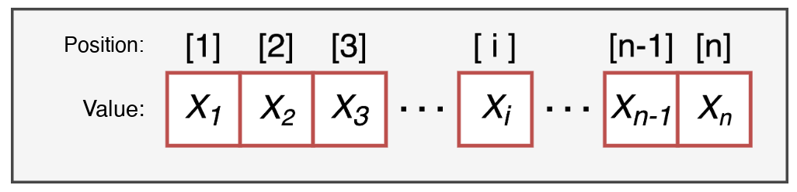

# Working directory

## Working directory

The **folder** where R reads and saves files, unless we tell it otherwise

```{r, echo=TRUE, eval=FALSE}
getwd()                              # where am I working?
# change the working directory
setwd("/Users/tita/Desktop/introR")
```

::: fragment
-   **relative path**: starts from the working directory

```{r, echo=TRUE, eval=FALSE}
# the file is inside the working directory
data <- read.csv("prova.csv")
```

-   **absolute path**: the full address of the file on the computer

```{r, echo=TRUE, eval=FALSE}
data <- read.csv("/Users/tita/Desktop/prova.csv")
```
:::

## R Projects

The best solution: an **R Project** (`File > New Project...`)

-   it **sets the working directory automatically** to the project folder
-   so we can always use **relative paths**: the code works on any computer
-   it keeps all the files of a project (scripts, data, results) together

::: fragment
Open the project by double-clicking the **`.Rproj`** file: RStudio starts in the right folder
:::

# Objects

## Creating an object

We create an object with the **assignment arrow `<-`**: `name <- value`

```{r, echo=TRUE}
age <- 25
age            # to see its value, write its name
```

::: fragment
We can **overwrite** it, or use it to create **new objects**:

```{r, echo=TRUE}
age <- age + 1
age_in_months <- age * 12
age_in_months
```
:::


## Naming objects

-   names must **start with a letter**: `x1` yes, `1x` no
-   R is **case-sensitive**: `Name` and `name` are two different objects

```{r, echo=TRUE}
Name <- "Margherita"
name <- "margherita"
Name == name
```

::: fragment
The objects we create live in the **environment**: `ls()` lists them, `rm()` removes one, `rm(list =ls())` removes all

```{r, echo=TRUE}
rm(name)
ls()
rm(list = ls())
ls()
```
:::

## Data types

```{r, echo=TRUE}
class(3.14)        # numeric (double)
class(5L)          # integer
class("hello")     # character: always in quotes
class(TRUE)        # logical: TRUE or FALSE
```

::: fragment
Careful with quotes: `"5"` is text, not a number!

```{r, echo=TRUE, error=TRUE}
"5" + 1
```
:::

# Operators

## Mathematical operators

| operator | what it does              | example     | result |
|----------|---------------------------|-------------|--------|
| `+` `-`  | addition, subtraction     | `5 + 2 - 1` | `6`    |
| `*` `/`  | multiplication, division  | `6 * 2 / 4` | `3`    |
| `^`      | power                     | `2 ^ 3`     | `8`    |
| `%%`     | remainder of the division | `9 %% 2`    | `1`    |

R follows the order of operations of mathematics: use **parentheses** when in doubt

```{r, echo=TRUE}
1 + 2 * 3
(1 + 2) * 3
```

## Mathematical functions

```{r, echo=TRUE}
sqrt(16)            # square root
abs(-7)             # absolute value
round(3.14159, 2)   # round to 2 decimals
exp(1)              # exponential
log(10)             # natural logarithm
```

## Relational operators

They **compare** two values and return **`TRUE`** or **`FALSE`**

| operator  | meaning                | example             | result  |
|-----------|------------------------|---------------------|---------|
| `==` `!=` | equal, different       | `5 == 5`            | `TRUE`  |
| `>` `>=`  | greater (or equal)     | `5 > 7`             | `FALSE` |
| `<` `<=`  | less (or equal)        | `5 <= 5`            | `TRUE`  |
| `%in%`    | is it contained in...? | `2 %in% c(1, 2, 3)` | `TRUE`  |

::: fragment
Remember: **`=`** (or `<-`) assigns, **`==`** compares!
:::

## Logical operators

They **combine** several conditions

```{r, echo=TRUE}
x <- 30
x > 25 & x < 60    # AND: both must be TRUE
x < 18 | x > 60    # OR: at least one must be TRUE
!(x > 25)          # NOT: inverts TRUE and FALSE
```

::: fragment
Order of evaluation: **mathematical**, then **relational**, then **logical** operators

```{r, echo=TRUE}
2 * 3 > 5 & 10 %% 2 == 0
```
:::

## TRUE and FALSE are numbers

In calculations, **`TRUE` counts as 1** and **`FALSE` as 0**

```{r, echo=TRUE}
TRUE + TRUE
answers <- c(TRUE, FALSE, TRUE, TRUE)
sum(answers)    # how many TRUE?
mean(answers)   # proportion of TRUE
```

::: fragment
Very useful to **count** how many values meet a condition:

```{r, echo=TRUE}
scores <- c(18, 25, 30, 22, 27)
sum(scores >= 25)   # how many scores are at least 25?
```
:::

# Vectors

## What is a vector

A **one-dimensional** sequence of elements, **all of the same type**. Each element has a **value** and a **position**.

{fig-align="center"}

```{r, echo=TRUE}
temps <- c(12, 18, 25, 31, 7)
length(temps)     # number of elements
```

## Creating vectors

::: fragment
```{r, echo=TRUE}
c(4, 8, 15)                         # combine values
```
::: 

::: fragment
```{r, echo=TRUE}
1:5                                 # integers from 1 to 5
```
::: 

::: fragment
```{r, echo=TRUE}
seq(from = 0, to = 10, by = 2)       # sequence with a step
```
::: 

::: fragment
```{r, echo=TRUE}
seq(from = 0, to = 1, length.out = 5) # sequence with a length
```
::: 

::: fragment
```{r, echo=TRUE}
rep(c("x", "y"), times = 2)          # repeat the whole vector
```
::: 

::: fragment
```{r, echo=TRUE}
rep(c("x", "y"), each = 2)           # repeat each element
```
::: 

## One type only

If we mix types, R converts everything to **one type** (usually character):

```{r, echo=TRUE}
mixed <- c(1, 2, "three")
mixed
class(mixed)
```

::: fragment
A missing value is written **`NA`** (not "NA"!) and does not change the type:

```{r, echo=TRUE}
with_na <- c(1, 2, NA, 4)
class(with_na)
```
:::

## Testing and converting: `is.` and `as.`

**`is.`** tests the type, **`as.`** converts it (when possible)

```{r, echo=TRUE}
nums <- c(1, 0, 3)
is.numeric(nums)
is.character(nums)
as.character(nums)
as.logical(nums)       # 0 is FALSE, others TRUE
```

::: fragment
```{r, echo=TRUE, warning=TRUE}
# what cannot be converted becomes NA
as.numeric(c("1", "2", "three"))
```
:::

## Operations on vectors

Operations are applied **element by element**:

```{r, echo=TRUE}
temps <- c(12, 18, 25, 31, 7)
temps * 9/5 + 32        # Celsius to Fahrenheit
temps > 20              # one TRUE/FALSE for each element
```

::: fragment
Summary functions return **one value** for the whole vector:

```{r, echo=TRUE}
mean(temps); sd(temps); max(temps); sum(temps)
```
:::

## Missing values: `NA`

```{r, echo=TRUE}
scores <- c(18, NA, 30, 22, NA)
mean(scores)                 # one NA makes the result NA
mean(scores, na.rm = TRUE)   # remove the NAs before computing
```

::: fragment
```{r, echo=TRUE}
is.na(scores)          # which elements are NA?
sum(is.na(scores))     # how many?
```
:::

# Indexing

## Indexing by position

Square brackets **`vector[position]`** select elements:

```{r, echo=TRUE}
temps <- c(12, 18, 25, 31, 7)
temps[2]                  # the second element
temps[c(1, 3)]            # the first and the third
temps[2:4]                # from the second to the fourth
temps[length(temps)]      # the last one
```

## Negative indexing

A **negative** position **excludes** that element:

```{r, echo=TRUE}
temps
temps[-1]                 # all except the first
temps[-c(1, 2)]           # all except the first two
temps[-length(temps)]     # all except the last
```

## Indexing by name

If the elements have **names**, we can select them by name:

```{r, echo=TRUE}
names(temps) <- c("Mon", "Tue", "Wed", "Thu", "Fri")
temps
temps["Wed"]
temps[c("Mon", "Fri")]
```

## Logical indexing

A **logical condition** inside the brackets keeps the elements where it is **`TRUE`**:

```{r, echo=TRUE}
temps > 20                  # the condition, for each element
temps[temps > 20]           # only the elements where it is TRUE
temps[temps > 10 & temps < 30]
```

::: fragment
**`which()`** gives the **positions** where the condition is `TRUE`:

```{r, echo=TRUE}
which(temps > 20)
```
:::

## Indexing to modify

Selecting elements and assigning a new value **modifies** only those elements:

```{r, echo=TRUE}
scores <- c(18, NA, 30, 22, NA)
scores[1] <- 20                   # change the first element
scores
```

::: fragment

```{r, echo=TRUE}
scores[is.na(scores)] <- 0        # replace the NAs with 0
scores
```

:::

::: fragment

```{r, echo=TRUE}
scores[scores < 21] <- 21         # raise the low scores to 21
scores
```

:::

## Summary

| to... | use |
|--------------------------|------------------------------|
| know / change the wd | `getwd()` / `setwd()`, or an R Project |
| create an object | `name <- value` |
| compare / combine conditions | `==` `!=` `>` `<` `%in%` / `&` <code>\|</code> `!` |
| create a vector | `c()`, `:`, `seq()`, `rep()` |
| test / convert a type | `is.numeric()`, `as.character()`, ... |
| deal with missing values | `is.na()`, `na.rm = TRUE` |
| select elements | `x[2]`, `x[-2]`, `x["name"]`, `x[x > 5]`, `which()` |
| modify elements | `x[condition] <- new_value` |

## Now let's practice! {style="text-align: center;"}

<br/> Open this link and keep it open:

<https://etherpad.wikimedia.org/p/arca-corsoR>
